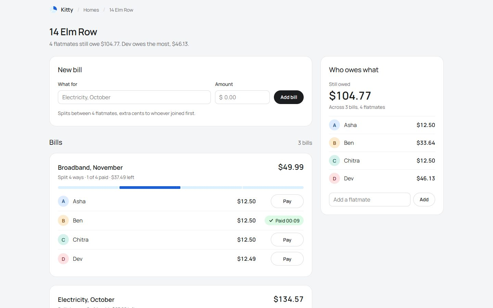

# Kitty: split the bills at home, to the cent

Kitty is a bill splitter for a shared home. You create a home, add the people who live there, and
add a bill. Kitty cuts the bill into one share per person, exact to the cent, and each person pays
their own share. A share can never be paid twice, even when the same request is retried or two
people press Pay at the same moment.



[](https://github.com/FrustratedBoy420/kitty-bill-splitter/actions/workflows/ci.yml)

## Stack

| Part     | Tech                                                                          |
| -------- | ----------------------------------------------------------------------------- |
| API      | [Hono](https://hono.dev) on Cloudflare Workers                                |
| Database | Cloudflare D1 (SQLite), schema in SQL migrations                              |
| Web      | React 19, Vite, TanStack Router, Motion, three.js (one lazy-loaded scene)     |
| Language | TypeScript, `strict` with `noUncheckedIndexedAccess`, no `any`                |
| Tests    | Vitest in the Workers runtime against real D1, plus fast-check property tests |
| Quality  | Biome (lint and format), CI on every push                                     |

## Run it

```bash
pnpm install
pnpm dev          # API on :8787, web on http://localhost:5173 (applies migrations first)
```

| Command          | What it does                                                                          |
| ---------------- | ------------------------------------------------------------------------------------- |
| `pnpm test`      | 54 tests: endpoints, edge cases, concurrency, property tests                          |
| `pnpm check`     | Biome lint and format                                                                 |
| `pnpm typecheck` | `tsc` on the API (including tests and scripts) and the web app                        |
| `pnpm build`     | Production build of the web app                                                       |
| `pnpm demo:race` | With `pnpm dev` running: fires parallel payments at the live API and prints PASS/FAIL |

If pnpm reports ignored build scripts, run `pnpm approve-builds` and allow `esbuild` and `workerd`.

## Features

- **Exact splits.** All money is whole cents. When a bill does not divide evenly, the extra cents
  go one each to the people who joined first: $10.00 between three people is $3.34, $3.33, $3.33.
- **Live preview.** The bill form shows each person's share before the bill is sent.
- **Safe payments.** Each payment carries an `Idempotency-Key`. A retry with the same key gets the
  same answer; a second payment with a different key gets `409`. The page reuses its key after a
  timeout or a reload, so a payment that did reach the server is never repeated.
- **Who owes what.** Each person's unpaid total across every bill of the home, in join order.
- **Honest states.** Every block has its own loading, empty and error state. A share only turns
  "Paid" after the server confirms it. If the answer never arrives, the page says it couldn't
  confirm the payment rather than claiming it failed.

## API

All amounts are integer cents. Every error is JSON: `{ "error": "message" }`.

| Method and path                                                         | Success                                                    | Errors                                  |
| ----------------------------------------------------------------------- | ---------------------------------------------------------- | --------------------------------------- |
| `POST /api/homes` `{ name }`                                            | `201 { id, name }`                                         | 400, 422                                |
| `GET /api/homes/:homeId`                                                | `200 { id, name, members }`                                | 404                                     |
| `POST /api/homes/:homeId/members` `{ name }`                            | `201 { id, homeId, name }`                                 | 400, 404, 422                           |
| `POST /api/homes/:homeId/bills` `{ title, totalCents }`                 | `201 { id, homeId, title, totalCents, shares }`            | 400, 404, 422 (bad total or no members) |
| `GET /api/homes/:homeId/bills`                                          | `200 { bills }`, newest first                              | 404                                     |
| `POST /api/bills/:billId/shares/:shareId/pay`, header `Idempotency-Key` | `200 { id, memberId, amountCents, paidAt }`                | 400 (no key), 404, 409                  |
| `GET /api/homes/:homeId/balances`                                       | `200 { balances: [{ memberId, name, outstandingCents }] }` | 404                                     |

## How it is verified

- **54 tests** run inside the Workers runtime on a real D1 database. They cover the endpoints,
  validation, 404s, large homes, and races, plus property-based tests that check the split rules
  on thousands of random bills and random bursts of parallel payments.
- **`pnpm demo:race`** shows the concurrency rules against the running API:

  ```text
  1) 12 parallel payments of Asha's share, each with its own key
     answers: 1 × 200, 11 × 409
     PASS: exactly one payment won
  2) 12 parallel retries of Ben's payment, all with the same key
     answers: 12 × 200, distinct paidAt values: 1
     PASS: every retry got the same answer
  ```

- **CI** runs `pnpm install && pnpm check && pnpm typecheck && pnpm test && pnpm build` on every
  push.

## Project layout

```
api/
  migrations/0001_init.sql   schema: 4 tables, 16 named constraints
  src/routes/                homes.ts, bills.ts (split, atomic writes, idempotent pay)
  src/                       validation, split, errors, row mappers
  test/                      visible, edge-case and property tests
  scripts/race-demo.ts       live concurrency demo
web/src/
  api.ts, guards.ts          typed client: timeout, runtime shape checks, never throws
  components/                homes screen, home screen, bills, pay button, split strip
  styles.css                 all design tokens
docs/                        structure, engineering notes, design notes
```

More detail: [`docs/STRUCTURE.md`](docs/STRUCTURE.md) (every file, and where each requirement is
proven), [`docs/ENGINEERING.md`](docs/ENGINEERING.md) (constraints, split, payment logic, status
codes), [`docs/DESIGN.md`](docs/DESIGN.md) (interface and states, with screenshots).

## Decisions

1. **Paying a share is one conditional `UPDATE`.** I wrote the payment as
   `UPDATE shares ... WHERE id = ? AND bill_id = ? AND paid_at IS NULL RETURNING ...`, so the check
   and the write happen in one statement. SQLite runs writes one at a time, so when two requests
   race, exactly one matches the unpaid row. The other request reads the share and gets `200` if it
   sent the same `Idempotency-Key` (the stored `paidAt` is replayed) or `409` if it sent a
   different key. Reading first and then writing would let both requests see "unpaid" and both pay.
   **Trade-off:** the key lives on the share row (`paid_key`), not in a general idempotency table.
   That keeps the payment and its key in one atomic write and is all this API needs, but the
   pattern does not carry over to other endpoints.
2. **The database enforces the rules, not only the code.** The schema has 16 named constraints.
   Composite foreign keys (`fk_shares_bill`, `fk_shares_member`) stop a share from linking a bill
   and a person from different homes. `chk_bills_total_positive` and
   `chk_shares_amount_non_negative` reject bad amounts; a share of 0 is allowed, because 2 cents
   between 3 people is 1, 1, 0. `uq_shares_bill_member` allows one share per person per bill, and
   `chk_shares_paid_consistent` keeps `paid_at` and `paid_key` set together. Join order comes from
   an `AUTOINCREMENT` `seq` column rather than a timestamp, so two people added in the same
   millisecond still have a fixed order.
3. **The split is a pure function, and one atomic batch writes the bill.** `splitCents` computes
   `floor(total / n)` and gives the remainder to the first people, using integers only. The bill
   row and all share rows go into one `DB.batch()`, which D1 runs as a single transaction, so a
   bill never exists without its shares. Shares are inserted 20 rows per statement, so a large home
   stays within D1's per-request query limit.

Smaller choices:

- **400 vs 422.** `400` only when the request cannot be read: the body is not JSON, or the
  `Idempotency-Key` is missing or blank. `422` for JSON that parses but has wrong fields, including
  a blank `name` or `title`, to match the 422 the brief uses for bad amounts. Fields are validated
  before any lookup.
- **No "list every home" endpoint.** Without accounts it would show every household to anyone. The
  web app remembers the homes created or opened in that browser; other people join through the
  home's link.
- **Trust boundaries.** The web client checks every API answer at runtime (`web/src/guards.ts`)
  instead of casting. On the server, row types trust the schema, which the constraints enforce.

## Known limits

- No accounts: anyone with a home's link can see it and pay its shares.
- Creating homes, people and bills is not idempotent; a retried create makes a duplicate.
- Nothing can be edited or deleted yet.
