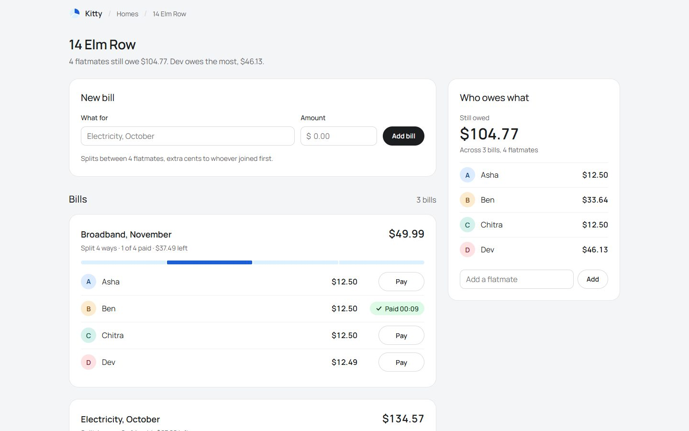
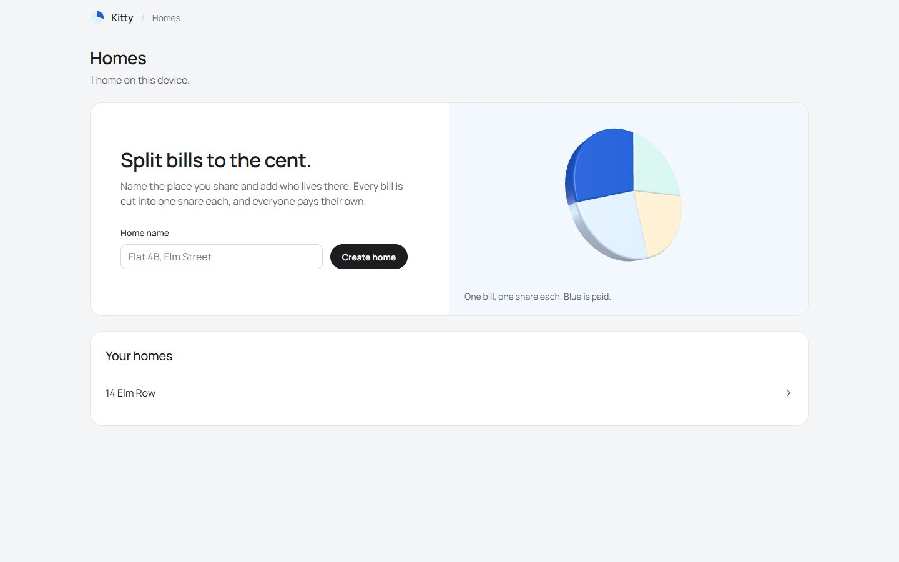
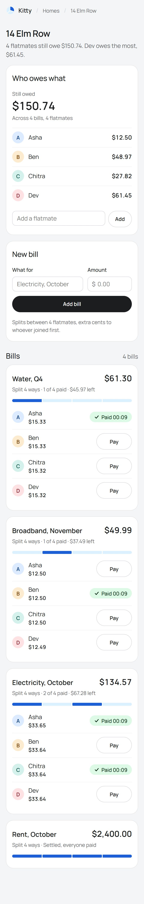
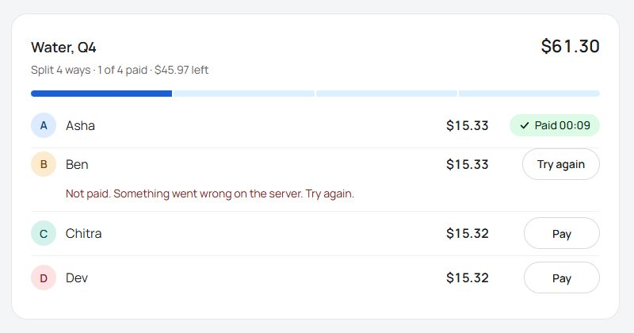
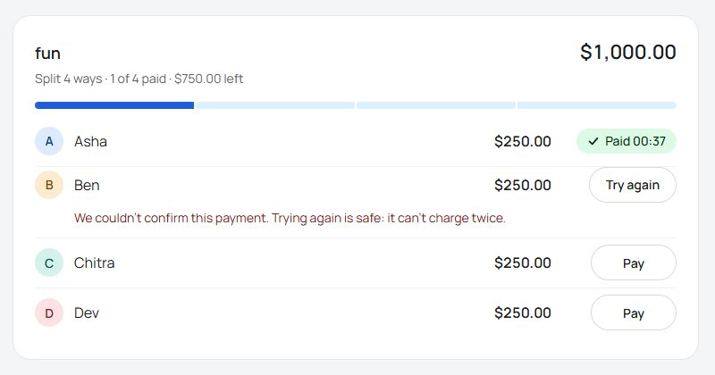
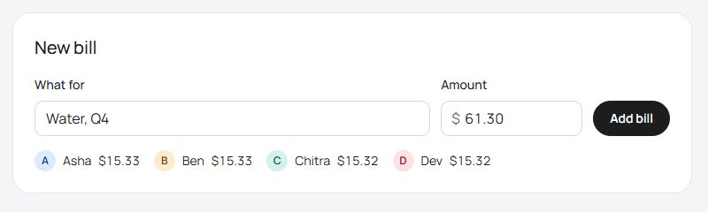
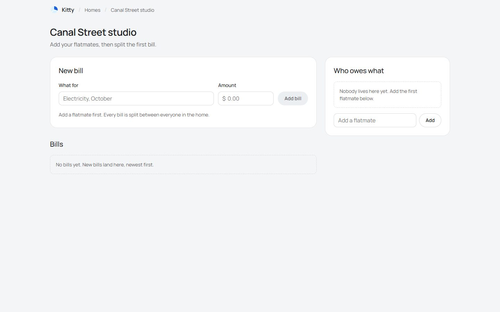
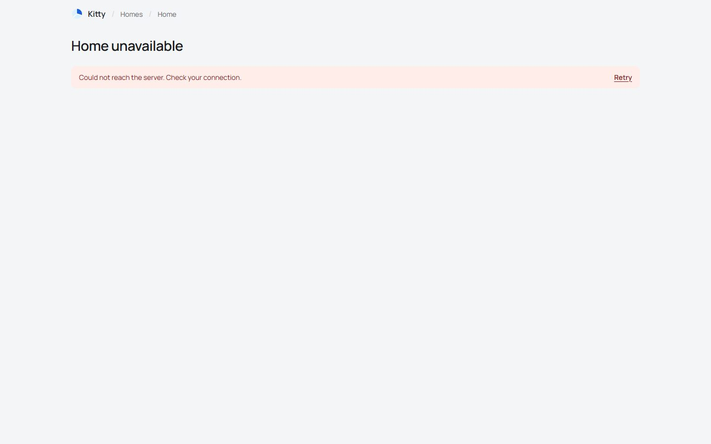

# Design

How the page looks and behaves, and why. Screenshots are from the running app with sample data.

## The one question

People open a home to answer **"Who still owes what?"**, then pay a share or add a bill. So:

- The largest figure on screen is the total still owed. The line under the title says who owes
  the most.
- Paying is one click on the row that needs it. Settled bills fold down to their strip.
- On a phone, "Who owes what" comes first.

## Look

**Kitty** is named after the pot of money flatmates share. Its mark is a coin cut into shares,
with one share filled.

| Choice                                                                                   | Why                                                            |
| ---------------------------------------------------------------------------------------- | -------------------------------------------------------------- |
| Flat white panels, 1px edge, no shadows or gradients                                     | Calm; nothing competes with the numbers                        |
| One typeface (Manrope), money in tabular figures                                         | Amounts line up digit for digit                                |
| Colour only where it means something: cobalt = paid money, green = "Paid", red = errors  | Any colour you see carries information                         |
| Each flatmate gets a pale tint by join order, neighbours ≥ 60° apart on the colour wheel | Tell people apart at a glance; tints are identity, never data  |
| **Split strip**: each bill drawn as one bar cut into its shares, paid parts in cobalt    | Shows how much of a bill is still out before you read a number |
| **Live split** in the bill form                                                          | You see each person's exact share before sending               |

## Screens

One route, two views: `/` (homes) and `/?homeId=…` (one home). The home ID is in the URL, so a
link opens the same home on any device, and opening it adds it to that device's homes list.

|                                                                                                                                                           |                                                                                               |
| --------------------------------------------------------------------------------------------------------------------------------------------------------- | --------------------------------------------------------------------------------------------- |
|  |  |
| _Homes: create a home; homes on this device._                                                                                                             | _390px: question first, two-line share rows._                                                 |

**The 3D coin** (Homes only) is the mark in three.js: four bevelled wedges, the paid one in
cobalt. It sways (never edge-on), leans toward the pointer and parts on hover. It is lazy-loaded so
the bill screens never download three.js, stops drawing when scrolled away, is one still frame with
reduced motion, and falls back to the flat SVG mark without WebGL.

## Paying

| State                         | Looks like                                                                       |
| ----------------------------- | -------------------------------------------------------------------------------- |
| Idle                          | White pill, "Pay"                                                                |
| Paying                        | Spinner, "Paying", disabled                                                      |
| Paid                          | Green pill, "Paid 17:54"; the strip segment fills; totals ease to the new value  |
| Rejected (4xx/5xx)            | "Try again", one short shake, "Not paid. _reason_" under the row                 |
| No answer (offline, timeout)  | "We couldn't confirm this payment. Trying again is safe: it can't charge twice." |
| Paid by another request (409) | "This share was already paid."; the card refreshes                               |

|                                                                                                                              |                                                                                                                                       |
| ---------------------------------------------------------------------------------------------------------------------------- | ------------------------------------------------------------------------------------------------------------------------------------- |
|  |  |
| _Server answered 500._                                                                                                       | _No answer: we don't claim it failed._                                                                                                |

## States

Every block owns its loading, empty and error state; one failed request never blanks the page.

| Block         | Loading                | Empty                                              | Error                               |
| ------------- | ---------------------- | -------------------------------------------------- | ----------------------------------- |
| Title line    | Grey bar               | "Add your flatmates, then split the first bill."   | follows the home                    |
| New bill      | Skeleton               | Inputs disabled + "Add a flatmate first…"          | Box under the form                  |
| Bills         | Card skeleton          | "No bills yet. New bills land here, newest first." | Box + Retry                         |
| Who owes what | Figure + row skeletons | "Nobody lives here yet…"                           | Box + Retry                         |
| Whole home    | —                      | —                                                  | "Home unavailable" + reason + Retry |

Skeletons are flat grey bars at the real size of what they replace, with no shimmer.

|                                                                                          |                                                                                                                    |
| ---------------------------------------------------------------------------------------- | ------------------------------------------------------------------------------------------------------------------ |
|  |  |
| _A home with nobody in it._                                                              | _API stopped._                                                                                                     |

## Motion

Motion answers an action; nothing moves on page load except the coin on the Homes screen.
`MotionConfig reducedMotion="user"` drops movement when the OS asks.

| Move                                    | When                       | Library           |
| --------------------------------------- | -------------------------- | ----------------- |
| Pay label swap, Paid pill, failed shake | Click Pay / answer arrives | Motion            |
| Strip segment fills from the left       | A share becomes paid       | Motion            |
| New bill slides in, others glide down   | Bill added                 | Motion (`layout`) |
| Totals ease to their new value          | A balance changes          | Motion            |
| Press scale, hover tone                 | Pointer                    | CSS               |
| Coin sway, tilt, parting                | Homes screen               | three.js          |

## Phone

Above 960px: main column plus a sticky 360px side panel. Below 960px: one column with "Who owes
what" first. Below 640px: 16px margins, 44px touch targets, share rows on two lines (name over
amount, Pay on the right), and full-width form buttons.

## Accessibility

One `h1` per view; panels labelled by their headings. Every input has a label. Pay buttons are
named in full ("Pay $12.50 for Chitra"). Errors use `role="alert"`, the live split uses
`aria-live`. A visible focus ring is on every control. All text is at least 4.5:1 contrast
(muted grey 6.3:1, disabled button 5.5:1). Colour is never the only signal.

## Libraries

| Library                                  | Used for                                                        | Licence |
| ---------------------------------------- | --------------------------------------------------------------- | ------- |
| Motion                                   | Pay morph, strip fill, list layout, money change                | MIT     |
| three.js                                 | The coin on the Homes screen (lazy chunk, about 141 kB gzipped) | MIT     |
| Manrope (`@fontsource-variable/manrope`) | The typeface, self-hosted                                       | OFL     |

The Pay button follows the idle → loading → done/error morph pattern popular on 21st.dev,
rebuilt on Motion with this app's tokens.
