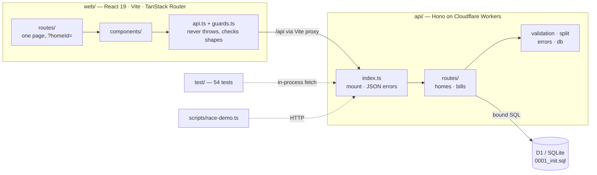

# Project structure

Where everything lives, the rules that keep it that way, and where each requirement is proven.

| Doc                                | Answers                                                |
| ---------------------------------- | ------------------------------------------------------ |
| **`STRUCTURE.md`** (this file)     | Layout, layering, conventions, proof map               |
| [`ENGINEERING.md`](ENGINEERING.md) | The money rules: constraints, split, pay, status codes |
| [`DESIGN.md`](DESIGN.md)           | How the interface looks and behaves                    |

## 1. The shape



Three rules hold it together:

1. **Each money rule lives in one place.** The split is `api/src/split.ts`. Paying is one SQL
   statement in `api/src/routes/bills.ts`. The schema backs both with constraints.
2. **Errors have one owner per side.** On the API, `app.onError` writes every error body. On the
   web, `api.ts` turns every failure into `{ ok: false, error }` and checks every answer with a
   guard, so components never `try/catch` or cast.
3. **Every requirement has a test or a script next to it** (§5).

## 2. Tree

```
.
├── .github/workflows/ci.yml        install → check → typecheck → test → build, on every push
├── README.md                       Brief, project tour, Decisions
├── package.json                    Scripts: dev, test, check, typecheck, build, demo:race
├── biome.json                      Lint + format (generated route tree excluded)
│
├── api/
│   ├── wrangler.jsonc              Worker entry, D1 binding `DB`
│   ├── migrations/0001_init.sql    4 tables, 16 named constraints, 3 indexes
│   ├── src/
│   │   ├── index.ts                Health, routers, JSON 404, JSON 500
│   │   ├── errors.ts               ApiError + 400/404/409/422 helpers
│   │   ├── validation.ts           JSON body, text, positive cents, Idempotency-Key
│   │   ├── split.ts                splitCents(): integer split, extra cents to earliest
│   │   ├── db.ts                   Row and API types, mappers, findHome()
│   │   └── routes/
│   │       ├── homes.ts            POST home, GET home, POST member, GET balances
│   │       └── bills.ts            POST bill (one batch), GET bills (one query), POST pay
│   ├── test/
│   │   ├── helpers.ts, apply-migrations.ts, env.d.ts      given, unchanged
│   │   ├── homes.test.ts, bills.test.ts, payments.test.ts  given visible tests, unchanged
│   │   ├── edge-cases.test.ts      added: validation, races, 404s, large homes, no listing
│   │   └── properties.test.ts      added: fast-check properties for split and pay
│   └── scripts/race-demo.ts        `pnpm demo:race`: live concurrency proof
│
├── web/src/
│   ├── main.tsx                    Router, font, CSS
│   ├── routes/__root.tsx           Reduced-motion config, root error screen
│   ├── routes/index.tsx            ?homeId → HomePicker | HomePage
│   ├── routeTree.gen.ts            Generated by TanStack Router (committed)
│   ├── api.ts                      fetch wrapper: timeout, safe JSON, guard, ApiResult<T>
│   ├── guards.ts                   Runtime shape checks for API answers
│   ├── storage.ts                  Homes on this device; pending payment keys
│   ├── useResource.ts              loading / error / ready for one GET
│   ├── money.ts · people.ts        Cents formatting and parsing; flatmate tints
│   ├── styles.css                  All design tokens and styles
│   └── components/
│       ├── ui.tsx                  Shell, Mark, Avatar, ErrorBox, Skeleton, ResourceView, useSubmit
│       ├── HomePicker.tsx          Homes screen (+ lazy CoinScene.tsx, three.js)
│       ├── HomePage.tsx            Home screen: finding, NewBill, bills, WhoOwes
│       ├── BillList.tsx            Bill cards, share rows, pay flow
│       ├── PayButton.tsx · SplitStrip.tsx · AnimatedMoney.tsx
│
└── docs/                           STRUCTURE · ENGINEERING · DESIGN, screenshots in design/screens
```

## 3. Layers

| Layer                  | May                                                              | May not                                        |
| ---------------------- | ---------------------------------------------------------------- | ---------------------------------------------- |
| `api/src/routes/*`     | Read params, validate, run bound SQL, map rows, throw `ApiError` | Write error JSON; import another router        |
| `validation.ts`        | Throw 400/422                                                    | Touch the database                             |
| `split.ts`             | Pure maths                                                       | Any I/O or import                              |
| `index.ts`             | Mount, `notFound`, `onError`                                     | Route logic                                    |
| `web/src/components/*` | Use `api.ts`, `useResource`, `storage.ts`                        | Call `fetch`, touch storage, hard-code colours |

## 4. Conventions

| Topic    | Convention                                                                                                    |
| -------- | ------------------------------------------------------------------------------------------------------------- |
| Money    | Integer cents everywhere; dollars only as strings for input and display                                       |
| IDs      | `crypto.randomUUID()`; `seq` columns never leave the API                                                      |
| Naming   | `snake_case` in SQL, `camelCase` in JSON and TS; mappers convert                                              |
| Types    | `strict`, `noUncheckedIndexedAccess`, no `any`; untrusted data enters as `unknown` and is narrowed by a guard |
| SQL      | `.prepare().bind()` only; multi-row writes in one `batch`                                                     |
| Comments | Explain why, not what                                                                                         |
| Commits  | Conventional Commits (`feat:`, `fix:`, `test:`, `docs:`, `chore:`)                                            |

## 5. Where each requirement is proven

| Requirement              | Code                                                                    | Proof                                                                 |
| ------------------------ | ----------------------------------------------------------------------- | --------------------------------------------------------------------- |
| ≥ 3 named constraints    | `0001_init.sql` (16)                                                    | ENGINEERING.md says what each one stops                               |
| Errors are JSON          | `index.ts`                                                              | `edge-cases`: invalid JSON, unknown route                             |
| 1. Home with no members  | `bills.ts` → 422                                                        | `bills.test` · `edge-cases` (nothing written)                         |
| 2. Bad amounts           | `validation.ts`                                                         | `bills.test` (5 values) · `edge-cases` (5 more)                       |
| 3. Uneven split          | `split.ts`                                                              | `bills.test` · `edge-cases` · 4 properties × 2,000 random cases       |
| 4. Same request twice    | `bills.ts` replay via `paid_key`                                        | `payments.test` · `edge-cases` · property · `demo:race`               |
| 5. Two pays at once      | `bills.ts` conditional `UPDATE`                                         | `edge-cases` (5 parallel) · property (40 random bursts) · `demo:race` |
| 6. Missing bill or share | `bills.ts` 404                                                          | `payments.test` · `edge-cases` (share of another bill)                |
| 7. API 500 or slow       | `web/src/api.ts`, per-block `ErrorBox`, "couldn't confirm" on no answer | DESIGN.md screenshots                                                 |
| Large homes              | chunked multi-row inserts                                               | `edge-cases`: 45 members                                              |
| No data exposure         | no `GET /api/homes`                                                     | `edge-cases`: listing answers 404                                     |
| check / typecheck / test | —                                                                       | `.github/workflows/ci.yml`                                            |

## 6. Commands

| Command                                        | Does                                                              |
| ---------------------------------------------- | ----------------------------------------------------------------- |
| `pnpm dev`                                     | Migrations, API on :8787, web on :5173                            |
| `pnpm test`                                    | 54 tests in the Workers runtime against real D1                   |
| `pnpm check` · `pnpm typecheck` · `pnpm build` | Biome, `tsc` (api incl. tests and scripts, web), production build |
| `pnpm demo:race`                               | With `pnpm dev` running: parallel payments, prints PASS/FAIL      |

## 7. Extending

- **Endpoint:** handler in the owning router; validate with `validation.ts`; throw `ApiError`; add
  a test; add a typed helper and a guard on the web side.
- **Schema change:** new `api/migrations/0002_<what>.sql`, never edit `0001`; name every constraint.
- **Screen block:** `useResource` + `ResourceView`, with a skeleton, an empty sentence and an
  `ErrorBox`; tokens from `styles.css`.
